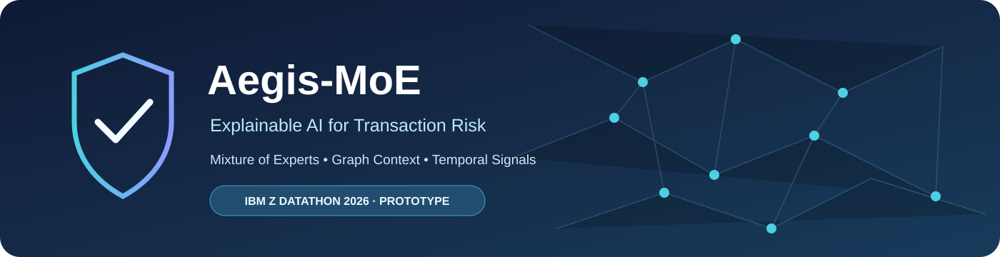
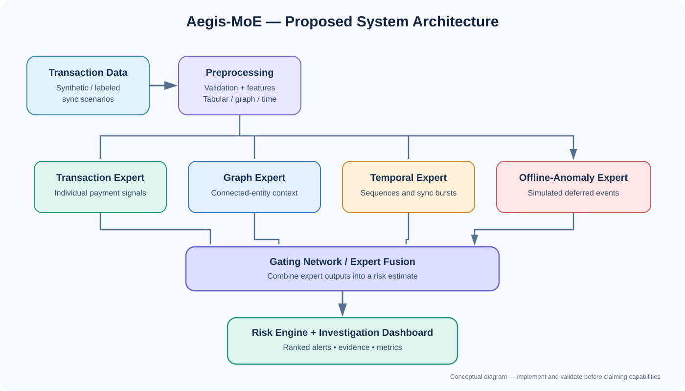
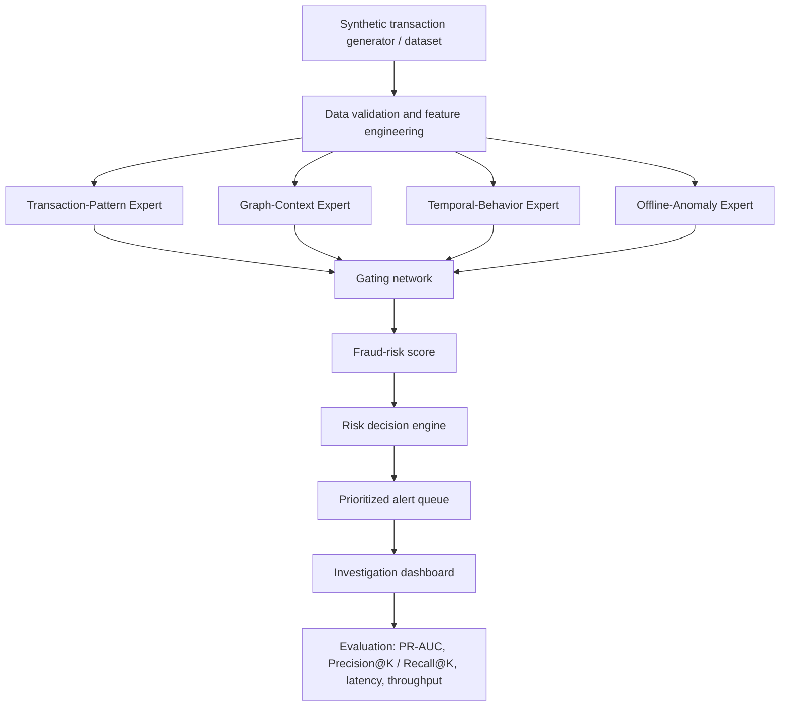
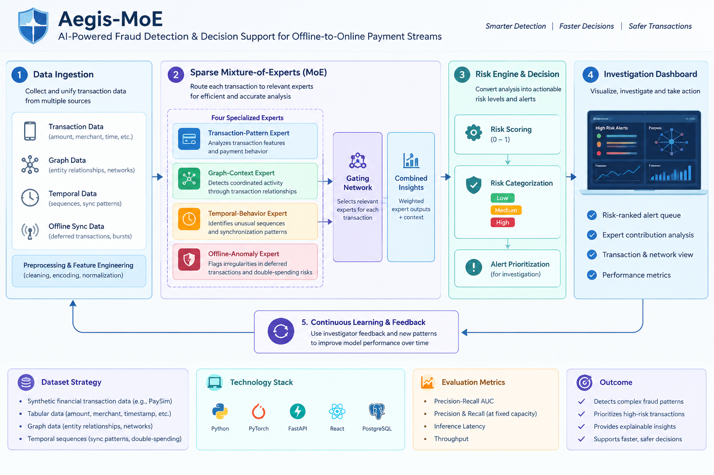
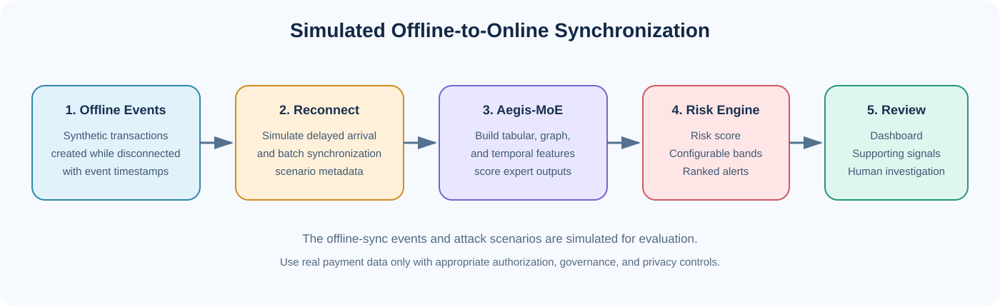
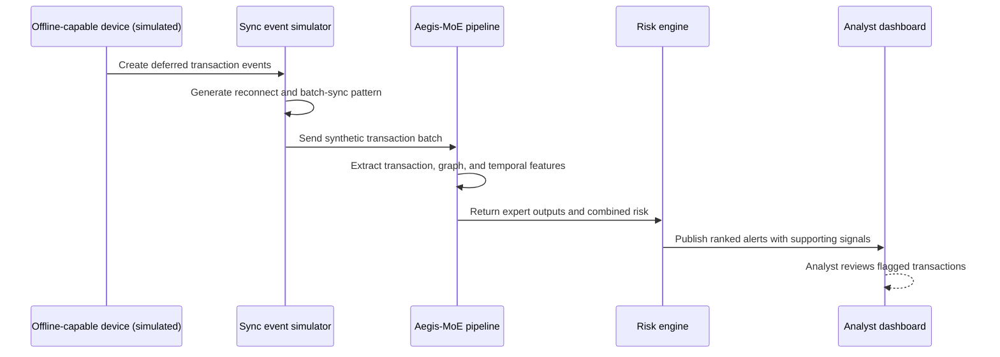

<div align="center">



# 🛡️ Aegis-MoE

### Explainable Mixture-of-Experts Fraud Detection for Transaction Streams

**IBM Z Datathon 2026 · Real-Time AI for Critical Decisions**

[](#project-status)
[](#proposed-architecture)
[](#problem-statement)
[](#dataset-strategy)

*Aegis-MoE explores how specialized AI experts can help identify
suspicious transactions, analyze connected activity, and prioritize
alerts during simulated offline-to-online synchronization bursts.*

</div>

------------------------------------------------------------------------

## 📌 Overview

Offline-capable payment experiences can create a difficult monitoring
scenario: transactions created while devices are disconnected may arrive
at a central system in a burst when connectivity returns. Aegis-MoE is a
proposed fraud-detection and decision-support prototype for
investigating this scenario.

The system combines four specialized experts through a gating network,
then turns model output into risk-ranked alerts for an investigation
dashboard. The project will use **synthetic transaction data and
explicitly simulated offline-sync events**; it is not presented as a
validated production NFC defense system.

> **Current status:** Project concept / prototype in development.
> Replace this status and the planned components below with verified
> implementation details as the code is completed.

## 🎯 Problem Statement

When offline-capable payment devices reconnect, batches of deferred
transactions may synchronize together. Within these bursts, suspicious
transaction behavior, coordinated activity, or simulated deferred
double-spending scenarios may be harder to distinguish from legitimate
activity.

A system that evaluates transactions individually can miss useful
context from connected entities and changes over time. Investigators
also need to prioritize limited review capacity instead of treating
every alert equally.

Aegis-MoE explores a graph-aware, temporal fraud-analysis workflow that
produces risk scores, supporting signals, and prioritized alerts under
measurable processing constraints.

### Project objectives

- Identify suspicious transaction patterns in labeled synthetic data.
- Use graph relationships to surface potentially coordinated activity.
- Analyze temporal sequences and simulated synchronization bursts.
- Combine specialized expert outputs through a gating network.
- Present risk-ranked alerts and model signals in a dashboard.
- Evaluate detection quality, latency, and throughput without claiming
  unmeasured performance.

## 💡 Proposed Solution

Aegis-MoE uses a **Mixture-of-Experts (MoE)** design. Each expert
focuses on a different view of a transaction, and a gating network
combines their outputs into a fraud-risk estimate.

| Component                      | Responsibility                                                      | Example signals                                                    |
|--------------------------------|---------------------------------------------------------------------|--------------------------------------------------------------------|
| **Transaction-Pattern Expert** | Scores transaction-level behavior                                   | Amount, merchant, account history, transaction type                |
| **Graph-Context Expert**       | Analyzes links among accounts, devices, merchants, and transactions | Shared entities, repeated links, suspicious clusters               |
| **Temporal-Behavior Expert**   | Detects unusual sequences and changes over time                     | Transaction frequency, time gaps, burst size                       |
| **Offline-Anomaly Expert**     | Examines simulated deferred-sync and integrity anomalies            | Delayed arrival, reconnect batch, conflicting transaction patterns |
| **Gating Network**             | Weights expert contributions for a prediction                       | Expert scores and available input features                         |
| **Risk Decision Engine**       | Converts risk estimates into review priorities                      | Configurable risk bands and alert ranking                          |
| **Investigation Dashboard**    | Helps reviewers inspect alerts and evidence                         | Risk score, reason signals, timestamps, expert contributions       |

The experts and router are proposed components. Their exact model types
and input schemas should be documented after implementation.

## 🏗️ System Architecture





### Inference flow

1.  **Ingest:** Load a transaction or a batch of transactions.
2.  **Validate:** Check required fields, timestamps, and data quality.
3.  **Build features:** Prepare transaction-level, graph, and temporal
    signals.
4.  **Score with experts:** Generate expert-specific outputs.
5.  **Combine:** Use the gating network to combine outputs.
6.  **Prioritize:** Produce a risk score and configurable alert
    priority.
7.  **Inspect:** Display the alert and supporting signals for human
    review.
8.  **Evaluate:** Record model quality and processing measurements.

## 🔄 Aegis-MoE End-to-End Workflow

The following workflow illustrates how Aegis-MoE processes transaction data, combines specialized Mixture-of-Experts predictions, prioritizes fraud alerts, and supports investigation through an interactive dashboard.

<p align="center">
  
</p>

*Figure: Proposed end-to-end workflow of Aegis-MoE.*

## 🔄 Offline-Synchronization Scenario



The synchronization scenario is **simulated for the prototype**. It does
not imply that the dataset contains real NFC records or that the model
has been validated against real-world offline payment attacks.



## 🧠 MoE Design

A Mixture-of-Experts model contains multiple specialist models and a
**router/gating network** that determines how their outputs contribute
to a prediction.

### Conceptual gating

For expert predictions (p_1, p_2, , p_4) and gating weights (g_1, g_2, ,
g_4), a simple weighted combination can be represented as:

\[ p\_{} = \_{i=1}^{4} g_i p_i \]

where the weights are non-negative and sum to one. This equation is a
conceptual illustration; the final implementation may use a different
routing and fusion design.

**Important:** Four separate models do not automatically constitute a
sparse MoE. Document the router, expert activation policy, training
approach, and measured compute behavior before describing the
implementation as sparse or claiming reduced computational cost.

## 📊 Dataset Strategy

The initial plan is to use **synthetic financial transaction data**,
enriched with simulated offline-sync patterns and labeled fraud
scenarios.

| Data view            | Candidate fields / structures                                            | Purpose                         |
|----------------------|--------------------------------------------------------------------------|---------------------------------|
| Tabular transactions | Transaction ID, account/entity IDs, amount, timestamp, merchant, label   | Transaction-pattern analysis    |
| Graph/network        | Account, device, merchant, and transaction nodes; relationships as edges | Connected-activity analysis     |
| Temporal sequences   | Event time, arrival/sync time, sequence order, batch identifier          | Burst and delayed-sync analysis |
| Scenario labels      | Normal / suspicious labels and simulated scenario type                   | Training and evaluation         |

### Candidate data source

- **PaySim:** A synthetic mobile-money transaction dataset that may be
  adapted as a starting point. Verify its schema, license, label
  meaning, and suitability before use.
- **Custom scenario generator:** Add simulated reconnect batches,
  delayed arrivals, and controlled suspicious patterns. Keep
  scenario-generation rules separate from model inputs to reduce
  accidental label leakage.

The prototype should split data by time or scenario where appropriate.
If graph entities overlap across splits, document that choice because it
can affect evaluation.

## 📈 Evaluation Plan

No performance numbers are claimed until experiments have been run and
recorded.

| Metric                | Why it matters                                                                   |
|-----------------------|----------------------------------------------------------------------------------|
| **PR-AUC**            | Useful for evaluating detection when fraud examples are rare                     |
| **Precision@K**       | Measures how many of the top K alerts are relevant to investigators              |
| **Recall@K**          | Measures how much labeled fraud is captured within a review capacity             |
| **Confusion matrix**  | Shows false positives and false negatives at a chosen threshold                  |
| **Inference latency** | Measures model processing time; report hardware and percentile such as p50 / p95 |
| **Throughput**        | Measures transactions processed per second under a defined test setup            |
| **Calibration**       | Checks whether predicted risk scores correspond to observed frequencies          |

Report the baseline model and MoE results under the same data split and
hardware conditions. Include preprocessing and graph-feature costs when
measuring end-to-end latency.

## 🖥️ Dashboard Components

The planned investigation dashboard can include:

- **Alert queue:** Sort and filter transactions by risk, timestamp, and
  scenario.
- **Transaction detail:** Show the selected transaction’s available
  features and context.
- **Risk explanation:** Show the strongest available signals supporting
  the score.
- **Expert contribution view:** Display gating weights or expert outputs
  if exposed by the implemented model.
- **Graph context:** Visualize connected entities where graph data is
  available.
- **Sync-burst timeline:** Show simulated event time, arrival time, and
  batch membership.
- **Evaluation panel:** Display validated metrics and benchmark
  settings.

> Dashboard visuals are proposed UI elements, not screenshots of a
> completed application. Add real screenshots to `assets/` after the
> interface is implemented.

## 🛠️ Suggested Technology Stack

These are implementation suggestions, not a claim that every component
is already integrated.

| Layer               | Candidate tools                               | Purpose                                |
|---------------------|-----------------------------------------------|----------------------------------------|
| Data processing     | Python, Pandas, NumPy                         | Validation and feature preparation     |
| ML training         | PyTorch, scikit-learn                         | Expert models, router, baselines       |
| Graph analysis      | NetworkX or a suitable graph-learning library | Build graph features and relationships |
| API (optional)      | FastAPI                                       | Serve predictions to a UI              |
| Dashboard           | Streamlit                                     | Interactive alert investigation        |
| Visualization       | Plotly / Matplotlib                           | Metrics, timelines, and graph views    |
| Experiment tracking | CSV/JSON logs or an experiment tracker        | Reproducible results                   |

## 📁 Suggested Repository Structure


``` text
Aegis-MoE/
├── README.md
├── requirements.txt
├── data/
│   ├── raw/                 
│   ├── processed/
│   └── synthetic/
├── configs/
│   └── default.yaml
├── src/
│   ├── data/
│   │   ├── generate_scenarios.py
│   │   └── preprocess.py
│   ├── features/
│   │   ├── transaction_features.py
│   │   ├── graph_features.py
│   │   └── temporal_features.py
│   ├── experts/
│   │   ├── transaction_expert.py
│   │   ├── graph_expert.py
│   │   ├── temporal_expert.py
│   │   └── offline_anomaly_expert.py
│   ├── models/
│   │   ├── gating_network.py
│   │   └── aegis_moe.py
│   ├── evaluation/
│   │   └── evaluate.py
│   └── app.py
├── tests/
├── assets/
│   ├── aegis-banner.svg
│   ├── architecture.svg
│   └── sync-workflow.svg
└── docs/
    └── experiments.md
```

## ⚙️ Getting Started

The commands below are a **suggested setup**. They will work only after
the repository contains the corresponding files and dependencies.

### 1. Clone the repository

``` bash
git clone <your-repository-url>
cd Aegis-MoE
```

### 2. Create and activate a virtual environment

``` bash
python -m venv .venv
```

Windows PowerShell:

``` powershell
.\.venv\Scripts\Activate.ps1
```

macOS / Linux:

``` bash
source .venv/bin/activate
```

### 3. Install dependencies

Once `requirements.txt` has been created:

``` bash
python -m pip install --upgrade pip
pip install -r requirements.txt
```

### 4. Run the prototype

Update this section to match the actual entry point after
implementation. For example, if a Streamlit app is created at
`src/app.py`:

``` bash
streamlit run src/app.py
```

## 🔐 Responsible Use and Limitations

- The initial dataset is synthetic; results may not generalize to real
  payment networks.
- Offline-sync events and deferred double-spending scenarios are
  simulations.
- A risk score is a decision-support signal, not proof that a
  transaction is fraudulent.
- Human review and appropriate escalation should remain part of the
  investigation workflow.
- Do not include real customer data, payment credentials, secrets, or
  sensitive identifiers in the public repository.
- Do not claim production readiness, IBM Z deployment, sub-millisecond
  latency, or reduced compute cost unless independently demonstrated.

## 🚀 Future Scope

- Compare the MoE against a single-model baseline and simpler ensemble.
- Add stronger graph-learning methods if justified by data and timeline.
- Improve score calibration and explanation quality.
- Test larger replay batches and document end-to-end performance.
- Explore deployment options for constrained or enterprise
  transaction-processing environments.
- Add a feedback loop for investigator-reviewed outcomes, subject to
  data governance.

## 👥 Team


## 📚 Resources Used

- 

------------------------------------------------------------------------

<div align="center">

**Aegis-MoE — Turning transaction signals into prioritized, explainable
decisions.**

*Prototype under development *

</div>
